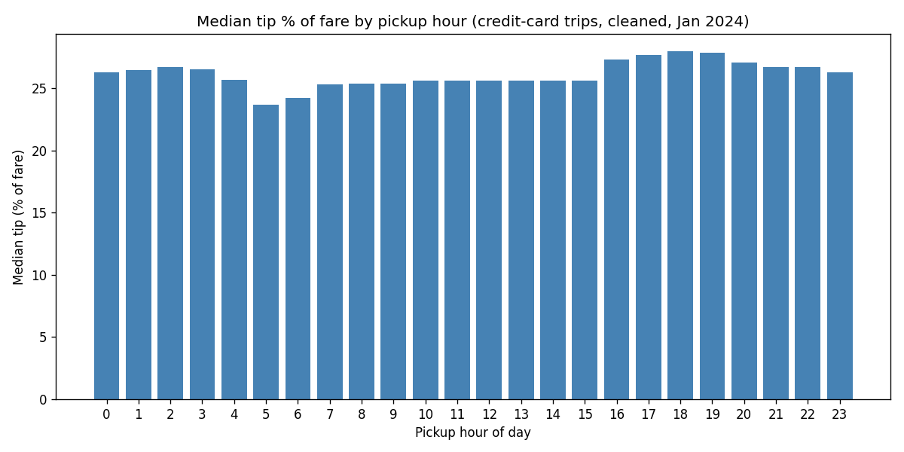

# archil-demo

A data-analyst AI agent whose workspace lives on an [Archil](https://archil.com) disk. The agent writes and runs Python against a real dataset (NYC Yellow Taxi trips, January 2024), saves its scripts and findings to the disk, and picks up where it left off on the next run. A live dashboard shows each step and every file the agent reads or writes.



## How it works

- **Persistent workspace.** The disk is mounted at `/mnt/archil/workspace`. Every bash command runs in a fresh container, so anything worth keeping (scripts, cleaned data, charts, `report.md`) is saved to the disk.
- **Builds on earlier work.** Before starting, the agent checks the disk for earlier scripts and reports and reuses them instead of starting over.
- **Live dashboard.** A small local server streams tool calls to `http://localhost:4321` over Server-Sent Events, showing steps, file reads and writes, and the final chart.
- **Audit trail.** Every tool call is appended to `.audit/<timestamp>.jsonl` on the disk, and runs are counted in `.demo/runs.jsonl`.

Built with the [Vercel AI SDK](https://ai-sdk.dev) (`ToolLoopAgent`), `@ai-sdk/anthropic`, and `@archildata/ai-sdk` for the disk tools.

## Project layout

| File | Purpose |
|---|---|
| `agent.mjs` | Entry point: sets up the agent, the disk tools, the audit log and the dashboard |
| `dashboard-server.mjs` | Serves `dashboard.html` and streams run events (no dependencies beyond `node:http`) |
| `dashboard.html` | The live run viewer |
| `tool-activity.mjs` | Turns tool calls into readable steps and works out which disk files each one touches |
| `replay.mjs` | Practice mode: plays a scripted run through the dashboard without calling any APIs |
| `analyze.py` | Quick sanity check that loads the dataset from the disk |
| `report.md`, `*.png` | Example output pulled down from the disk after a run |

## Setup

Requires Node.js 18+ and an Archil disk that holds the dataset at `data/taxi.parquet`, with Python libraries (pandas, pyarrow, matplotlib) installed under `pylib/`.

```bash
npm install
```

Set these environment variables:

| Variable | Description |
|---|---|
| `ANTHROPIC_API_KEY` | Anthropic API key |
| `ARCHIL_API_KEY` | Archil API key |
| `ARCHIL_REGION` | Region of your Archil disk |
| `ARCHIL_DISK_ID` | ID of the disk to use as the workspace |
| `MODEL` | Optional; defaults to `claude-sonnet-5-5` |

## Usage

```bash
# Run a task (opens the dashboard at http://localhost:4321)
node agent.mjs "Profile data/taxi.parquet for data quality problems, clean it, and summarize the key stats in report.md."

# A follow-up task that builds on the first run
node agent.mjs "Which pickup hours get the best tips? Build on the earlier work."

# Terminal output only
node agent.mjs --no-dashboard "your task"

# Practice run with fake data and no API calls (scenario 1 or 2)
node agent.mjs --replay 1
```

When a run finishes, `report.md` and the newest chart are downloaded from the disk into the current directory.

## Example results

From [`report.md`](report.md), produced by the agent:

- Cleaned 2,964,624 raw trips down to **2,826,978 (95.4%)** by removing bad timestamps, impossible distances, fares and speeds.
- The typical trip is 1.7 miles, takes about 12 minutes and has a $12.80 fare.
- Card tips run at a median of 25–26% of the fare, peaking at 27–28% in the evening (16:00–20:00).
- Trips peak at 17:00–18:00 and are fewest at 4:00.
